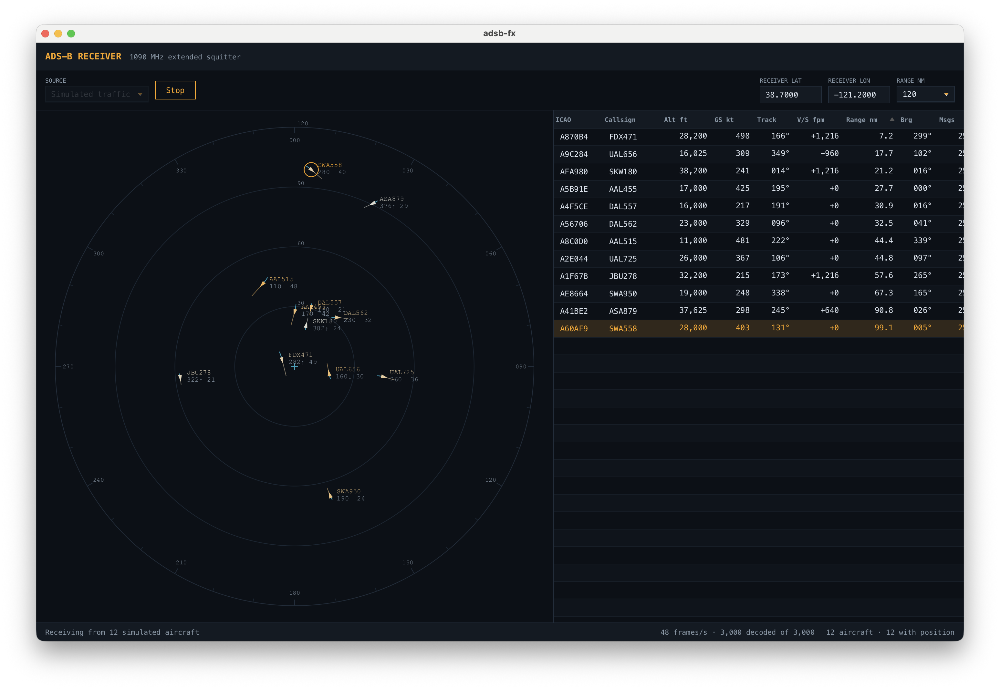

# adsb-fx-kotlin

A JavaFX desktop receiver for 1090 MHz ADS-B, written in Kotlin. It decodes Mode S
extended squitter frames itself — parity, CPR, altitude, velocity — and shows the
traffic as a live table plus a plan position display.



## Running it

There is no wrapper checked in. Generate one once with your local Gradle:

```bash
gradle wrapper --gradle-version 8.10
./gradlew run
```

### Without a dongle

Pick **Simulated traffic** in the source box, enter a receiver latitude and
longitude, and press **Start receiving**. The simulator encodes real, CRC-valid
DF17 frames for invented aircraft and feeds them through the same decode path as
live traffic, so it exercises everything except the radio.

### With a dongle

The app consumes AVR-format frames from `dump1090`. Either point it at a running
instance:

```bash
dump1090 --net --quiet          # serves raw frames on TCP 30002
```

then choose **dump1090 over TCP**, host `127.0.0.1`, port `30002` — or choose
**Launch dump1090** and let the app spawn `dump1090 --raw` itself and own the
process lifetime. Only one program can hold the USB device at a time, so those
two options are mutually exclusive.

`readsb` and `dump1090-fa` both work; set the command name accordingly.

Setting the receiver position unlocks range, bearing and the situation display,
and gives the tracker a reference for single-frame CPR decoding.

## Why dump1090 rather than talking to the dongle directly

Demodulating ADS-B means sampling at 2 MSPS, hunting the 8 µs preamble, slicing
PPM bits and error-correcting — a real DSP problem that `dump1090` already solves
well, in C, with years of field tuning behind it. Reimplementing it in Kotlin
would cost the accuracy without buying anything the interface needs.

The `AdsbSource` interface is the seam. A `RtlUsbSource` that drives `librtlsdr`
over JNA and demodulates in-process would drop in beside the existing three
implementations without the tracker or UI noticing — the same trade you hit in
`rtlsdr-fx`, where native linkage buys directness and costs "just run the jar".

## Layout

```
decode/   Bits, ModeS, Cpr, AdsbDecoder — stateless, no JavaFX, no I/O
model/    Aircraft, AircraftTracker, Geo — FX-thread confined
source/   AdsbSource + TCP, subprocess and simulated implementations
ui/       AdsbApp, AircraftTable, SituationDisplay, Palette
```

Threading is deliberately boring. Sources own their own threads and hand
immutable decoded messages to a `ConcurrentLinkedQueue`. An `AnimationTimer`
drains that queue on the FX thread and is the only thing that ever touches the
tracker, so the table binds straight to `Aircraft` properties with no locks and
no `Platform.runLater` per message.

CPR resolution lives in the tracker rather than the decoder because it needs
history: a position is only recoverable from a matched odd/even pair inside a
10-second window, or from a single frame plus a reference within half a zone.

## What the display shows

Each target is a chevron pointing along its track, tinted by altitude — amber low,
pale up high. The line ahead of it is one minute of travel at present groundspeed,
so leader length reads as speed. The block beside it is flight level, a climb or
descent arrow, and groundspeed in tens of knots. Faint blue behind it is the
recent track history.

## Known gaps

- **Gillham altitudes.** Frames with the Q bit clear (100 ft encoding, above
  FL500) return no altitude rather than a guess.
- **Beast binary format** (port 30005) is not parsed; AVR text only.
- **DF20/21 Comm-B** replies are ignored, so Mode S–only aircraft appear on the
  list via all-call replies but never gain a position.
- **No error correction.** Frames failing parity are dropped rather than
  single-bit repaired, which costs some range on a marginal antenna.
- **No aircraft registry lookup** — ICAO addresses are shown raw, not resolved to
  registration or type.

## Tests

```bash
./gradlew test
```

`AdsbDecoderTest` runs published reference frames through the decoder and checks
callsign, altitude, both CPR paths and velocity against known values.
`SimulatedSourceTest` round-trips the simulator's encoder through the decoder.
